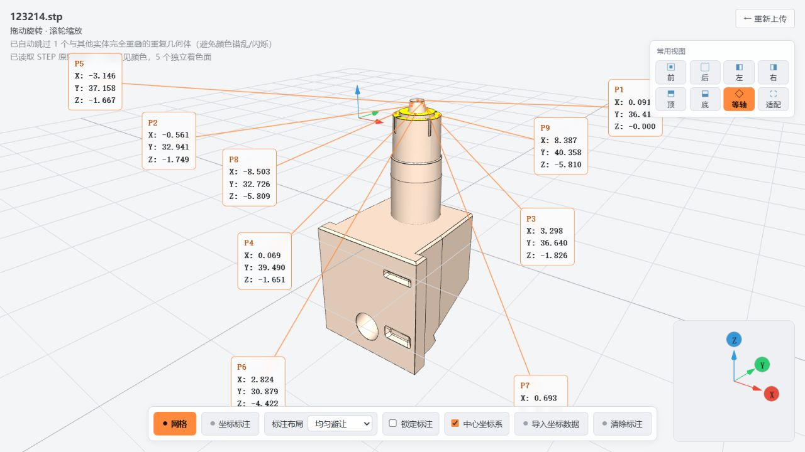
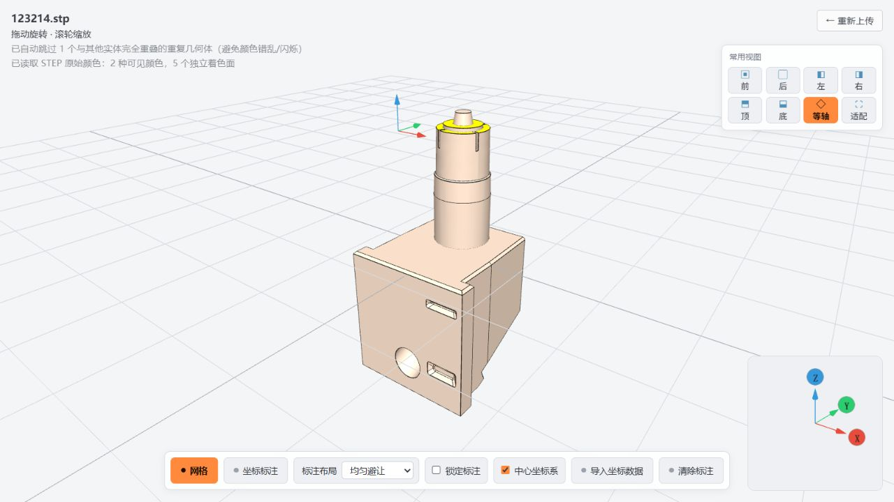

# PointView 3D

PointView 3D 是一个运行在浏览器中的三维模型查看与测点标注工具。它可以加载 STEP、STP、Parasolid X_T、OBJ 和 MTL 文件，也能把检测设备或测量软件导出的坐标数据直接标到模型上。

项目适合三坐标测量结果复核、工装测点检查、模型沟通和轻量 CAD 预览。服务只运行在本机，打开浏览器即可使用。



## 功能亮点

- 支持 `.stp`、`.step`、`.x_t`、`.obj` 和 `.mtl` 模型
- 在浏览器中解析 STEP 几何，无需安装桌面 CAD 软件
- 读取 STEP 的零件级与面级原始颜色，并修正导入器产生的颜色空间偏差
- 点击模型表面即可创建坐标标注
- 可选择 STEP、Parasolid 曲面或 OBJ 三角面，查看原始颜色、面积、坐标和法向信息
- 支持点到点测量，并可查看相对模型 X/Y/Z 参考轴的投影距离
- 支持粘贴数据，也支持导入 CSV 和 TXT 测点文件
- 提供“就近布局”和“均匀避让”两种标注排列方式
- 均匀避让会避开模型、坐标框和其他引导线，并让坐标框与模型保持最大边长 5% 的间隙
- 可以锁定坐标框的屏幕位置，旋转、平移和缩放模型时标注不会到处移动
- 提供前、后、左、右、顶、底、等轴测和适配窗口快捷视图
- 带有网格、模型原点坐标轴和右下角视角坐标轴
- 模型中心坐标系可以单独显示或隐藏
- 自动跳过完全重叠的 STEP 实体，减少颜色错乱和闪烁

## 快速开始

### Windows

在另一台 Windows 10/11 x64 电脑上，用 Git 克隆仓库，然后双击目录里的 `start.bat`。也可以在 PowerShell 中运行以下命令。

```powershell
git clone https://github.com/XiaoyeCodes/PointView-3D.git
cd PointView-3D
.\start.bat
```

X_T 转换器和运行库随主仓库一起下载，目标电脑可直接导入 `.x_t`，无需安装 NX 或登录 GitHub。首次启动需要联网。脚本会使用已有的兼容 Node.js 和 npm，缺少时会从 Node.js 官网下载、校验并解压到项目的 `.pointview` 目录，再按锁文件安装依赖。若缺少转换器所需的 .NET Framework，脚本会启动 Microsoft 安装程序，Windows 可能要求管理员授权。

浏览器打开后即可使用。所需文件齐全后可离线启动。后续运行 `git pull` 即可同时更新项目和运行库，再双击 `start.bat`。停止服务时双击 `stop.bat`。

如果旧版工作目录已初始化过运行库子模块，请在这次升级前执行一次 `git submodule deinit -- runtime/parasolid-win-x64`，再运行 `git pull`。首次克隆可直接启动。

脚本也支持无暂停模式，方便在终端或其他工具中调用。

```bat
start.bat --no-pause
stop.bat --no-pause
repair.bat --no-pause
```

### macOS 与 Linux

安装 Node.js 18 或更高版本后，在项目目录中运行：

```bash
npm install
npm start
```

服务启动后访问 [http://localhost:3000](http://localhost:3000)。

### 导入 Parasolid X_T

在上传页选择或拖入一个 `.x_t` 文件，点击“生成并打开预览”。预览按原曲面分组，读取文件中的 RGB 面颜色，保留原模型坐标。显示和导入测点的长度单位均为毫米。

在 Windows x64 上，上传的文件由仓库内的 `runtime/parasolid-win-x64/PointViewXt.exe` 调用同目录下的 Parasolid 内核解析。可读取的 X_T 版本取决于所用内核，本项目已验证 Parasolid 27.0.178。

**准备运行库**：本地构建脚本适用于 Windows x64、NX 10 的 UGII 目录结构及 Visual C++ 2012 x64 运行库。在有权使用这些组件的开发机上，从项目根目录执行：

```powershell
.\converters\kernel\prepare.ps1 -UgiiDirectory $env:UGII_ROOT_DIR
npm run test:xt
```

构建脚本编译转换器，并将内核、托管接口、C 运行库和 schema 文件放入 `runtime/parasolid-win-x64/`。仅在重新构建转换器时才需要执行此步骤。请按相应组件的许可在目标电脑使用运行库。

**已有 NX 的服务端**：缺少独立转换器时仍可使用 NX journal。服务从 `UGII_ROOT_DIR` 或 `UGII_BASE_DIR` 下的 `NXBIN` / `UGII` 查找 `run_journal`。两条路径都将原文件和预览网格保存在项目的 `uploads` 目录。

## 使用测试案例

仓库内置了一套真实 STEP 模型与 9 个测点，可以用来快速体验完整流程。

1. 启动服务并打开首页。
2. 上传 [`examples/123214/123214.stp`](examples/123214/123214.stp)。
3. 进入预览页后点击“导入坐标数据”。
4. 选择 [`examples/123214/coordinates.csv`](examples/123214/coordinates.csv)，也可以复制文件内容并粘贴到输入框。
5. 点击“生成标记点”。
6. 在底部工具栏切换“就近布局”和“均匀避让”，观察两种排列方式的区别。

测试文件来自本项目实际调试过程，截图也由这套模型与坐标数据生成。

下面是 `123214.stp` 的原始颜色读取效果。主体使用文件声明的浅褐色，顶部 5 个独立着色面使用黄色。



## 坐标文件格式

每行代表一个测点，使用英文逗号分隔。当前版本读取前四列，其余字段会被忽略。

```text
点号,X,Y,Z,其他字段...
1,0.0915,36.4164,-0.0002,0,0,1
2,-0.5608,32.9408,-1.7486,-0.169,-0.97,0.174
```

导入后，点号 `1` 会显示为 `P1`。空行以及以 `#` 或 `//` 开头的行不会参与解析。

坐标按照模型原始文件坐标系处理，与点击模型表面得到的坐标属于同一套坐标系。

## 基本操作

| 操作 | 结果 |
| --- | --- |
| 按住鼠标左键拖动 | 旋转视图 |
| 滚动鼠标滚轮 | 缩放视图 |
| 开启“坐标标注”后点击模型 | 新增一个表面坐标点 |
| 开启“面信息”后点击模型 | 高亮选中面并显示颜色、面积、坐标、法向等信息 |
| 开启“测量”后点击两个模型点 | 显示点到点距离、坐标差和参考轴向投影 |
| 点击“导入坐标数据” | 批量创建测点 |
| 切换“标注布局” | 在就近排列与均匀避让之间切换 |
| 勾选“锁定标注” | 固定坐标框位置，直线的测点端继续跟随模型 |
| 勾选或取消“中心坐标系” | 显示或隐藏模型原点处的坐标轴 |
| 点击“清除标注” | 移除当前全部测点 |
| 点击常用视图按钮 | 快速切换观察方向或适配窗口 |

## 项目结构

```text
PointView-3D
├─ docs
│  └─ images                  项目效果截图
├─ examples
│  └─ 123214
│     ├─ 123214.stp           测试模型
│     └─ coordinates.csv      测试坐标
├─ public
│  ├─ vendor                  浏览器端三维依赖
│  ├─ index.html              文件上传页
│  └─ viewer.html             三维查看器
├─ uploads                    本地上传文件目录
├─ server.js                  Express 服务
├─ repair.bat                 Windows 一键环境修复脚本
├─ start.bat                  Windows 启动脚本
└─ stop.bat                   Windows 停止脚本
```

## 技术实现

- Three.js 负责三维场景、模型渲染和交互
- OrbitControls 负责旋转与缩放
- occt-import-js 与 WebAssembly 负责浏览器端 STEP 解析
- Node.js、Express 和 Multer 负责本地服务与文件上传
- SVG 与 HTML 覆盖层负责测点、坐标框和直线引导线

前端依赖已经放在 `public/vendor` 中。运行项目时不依赖 CDN，离线局域网环境也可以使用。

## 文件与隐私

上传的模型保存在当前项目的 `uploads` 目录中，不会由项目代码发送到第三方服务。这个目录中的用户文件默认不会被 Git 提交。

单个模型文件的默认上限为 100 MB。公开部署前，建议根据实际环境补充访问控制、文件清理和上传频率限制。

## 开发说明

```bash
npm install
npm start
```

默认端口为 `3000`。可以通过环境变量指定其他端口。

```bash
PORT=8080 npm start
```

Windows PowerShell 可以使用下面的写法。

```powershell
$env:PORT = 8080
npm start
```

如果你发现模型或标注布局存在特殊情况，欢迎提交 Issue，并附上能够复现问题的模型格式、测点数量和视图方向。
